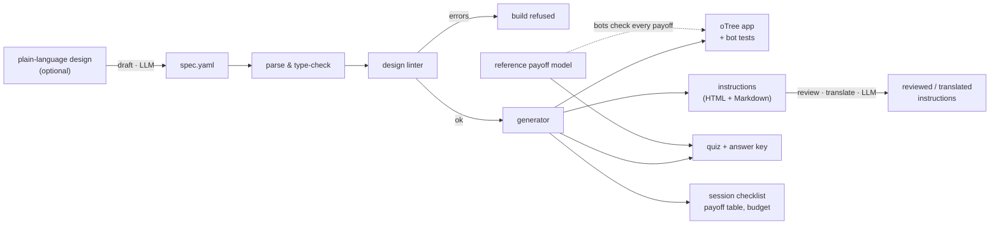

# lab-experiment-toolkit

**From a reviewed experimental design to a tested oTree app, participant instructions, a verified comprehension quiz, session materials, and a power analysis that respects how lab data are clustered.**

[](https://github.com/OWNER/lab-experiment-toolkit/actions/workflows/tests.yml)
  

Preparing a laboratory session involves many small artefacts that must agree with each other: the experiment software, the instructions read to participants, the comprehension questions and their answer key, the payment budget, and the analysis plan. When they are written by hand, they drift apart — a parameter changes in the code but not in the instructions, a quiz answer is computed with last week's MPCR, a power analysis counts decisions instead of sessions.

This toolkit makes **one YAML specification** the single source of truth and derives everything else from it, with tests that check the pieces against each other.

| Component | What it does |
|---|---|
| [`expbuilder`](expbuilder/) | Validates and lints a design specification, then generates a complete **oTree 5** app (with bot tests), participant instructions, a comprehension quiz whose answers are computed from the payoff model, a session checklist, and a payoff table. An optional **LLM agent** drafts specifications from plain language, reviews the instructions, and translates them with a number-preservation check. |
| [`otree_project`](otree_project/) | Four ready-to-run **public goods game** variants generated from [`examples/`](examples/): partner matching, stranger matching, peer punishment (Fehr & Gächter, 2000), and a provision-point game with money-back guarantee. Each app passes three bot scenarios that recompute every payoff against the reference model. |
| [`powersim`](powersim/) | Simulates session-clustered lab data and compares the **size and power** of six estimators, from naive OLS to the wild cluster bootstrap at the session level, plus analytic power and required-sessions calculations. |

---

## Quick start

```bash
git clone https://github.com/OWNER/lab-experiment-toolkit.git
cd lab-experiment-toolkit
python -m venv .venv && source .venv/bin/activate      # Python 3.9–3.12 (oTree 5 does not support 3.13)
pip install -e ".[dev]"

expbuilder lint examples/*.yaml                        # design checks
expbuilder build examples/*.yaml --project otree_project --docs docs/generated
cd otree_project && otree test pgg_punishment && otree devserver
```

Run the test-suite (78 tests, including all oTree bot scenarios) with `pytest`.

---

## 1 · expbuilder: specification → app, instructions, quiz, checklist



**A specification** ([full example](examples/pgg_punishment.yaml)):

```yaml
name: pgg_punishment
title: Public Goods Game with Peer Punishment
players_per_group: 4
num_rounds: 10
endowment: 20
mpcr: 0.4
matching: partner
session_size: 16
punishment: {enabled: true, max_points: 10, cost_per_point: 1, impact_per_point: 3, floor_at_zero: true}
payment: {rule: random_round, points_per_currency_unit: 2, currency_code: CNY, participation_fee: 15}
```

**The linter** encodes methodological rules that a type check cannot catch, at three levels (error · warning · info). Errors refuse the build:

```text
$ expbuilder lint bad_design.yaml          # mpcr: 1.2, matching: stranger, session_size: 10
[ERROR  ] PG001: MPCR = 1.2 >= 1: contributing is individually optimal, so the game is not a social dilemma.
[ERROR  ] SE001: Session size 10 is not a multiple of the group size 4.
[WARNING] SE002: Stranger matching with only 2 group(s) per session gives frequent re-matching; use >= 3 groups or a perfect-stranger protocol.
[INFO   ] MA001: Observations are not independent across groups within a session; cluster standard errors at the session level (see powersim).
[INFO   ] RO002: Contributions typically decline over rounds with an end-game drop; announce the number of rounds in the instructions and pre-register a round-trend analysis.
[INFO   ] SE004: 2 groups per session; with stranger matching the session, not the group, is the independent unit.

2 error(s), 1 warning(s), 3 note(s)
```

Checks include the social-dilemma condition `1/N < MPCR < 1`, threshold feasibility, punishment impact/cost ratio and negative earnings, session size versus group size, re-matching frequency under stranger matching, timeouts, salience of stakes, and the number of comprehension questions ([`lint.py`](expbuilder/lint.py)).

**The generated oTree app** ([example](otree_project/pgg_punishment/__init__.py)) contains: random grouping with partner or stranger re-matching; contribution and deduction stages with budget constraints enforced server-side; timeouts recorded explicitly; a comprehension quiz with a limited number of attempts and an explanation page for participants who do not pass; random-round or all-round payment; a history table; and a **custom export** in tidy long format (one row per participant and round, including the full punishment matrix).

**Why the quiz cannot be wrong.** Quiz answers are computed by the reference payoff model in [`games/public_goods.py`](expbuilder/games/public_goods.py). The generated app re-implements the payoff rules (an oTree app must run without this package), and its bots replay every round and assert that each participant's earnings equal the reference model's output. Changing a payoff rule in one place and not the other fails the test-suite — this is tested by deliberately corrupting the generated code.

**Session materials** ([example](docs/generated/pgg_punishment/)): `instructions.md`, `quiz_answer_key.md`, `session_checklist.md` (with the payment range for the session), `payoff_table.csv`, `lint_report.txt`.

### The LLM agent (optional)

```bash
pip install -e ".[agent]" && export ANTHROPIC_API_KEY=...
expbuilder draft "Four-person public goods game, stranger matching, 15 rounds, peer punishment at 1:3" -o design.yaml
expbuilder review examples/pgg_punishment.yaml
expbuilder translate examples/pgg_punishment.yaml --language "Simplified Chinese"
```

The agent works only where language models help and deterministic code cannot, and every output is checked by code:

- **draft** – the model writes a specification; it is parsed and linted, and parse or lint errors are returned to the model for repair (up to three turns). The researcher reads and approves the specification; the app is then generated deterministically.
- **review** – a critical reading of the generated instructions for ambiguity, loaded wording and inconsistencies with the design.
- **translate** – the translation is rejected if any number in it differs from the source, and the model is asked to correct it.

The client is injected, so the agent logic is tested offline ([`tests/test_agent.py`](tests/test_agent.py)).

---

## 2 · Public goods game apps

| Session config | Design |
|---|---|
| `pgg_partner` | 4-person VCM, E = 20, MPCR = 0.4, 10 rounds, fixed groups |
| `pgg_stranger` | same, groups re-formed every round |
| `pgg_punishment` | partner matching with peer punishment, up to 10 points per target, cost 1, impact 3, earnings floored at zero |
| `pgg_threshold` | provision point of 48 of 80 points with money-back guarantee |

Each app ships with bot tests for three scenarios: random play, a persistent free rider (who is punished by the others where punishment is available), and a participant who fails the comprehension quiz on every attempt.

---

## 3 · powersim: power when the session is the unit of randomisation

When treatments are assigned to whole sessions, decisions are correlated within participants, groups and sessions, and the number of independent observations is the number of sessions. Treating 1,600 decisions as independent gives a very different answer from treating 8 sessions as independent.

```bash
powersim --sessions 2 3 4 6 8 10 --effect 0 0.10 --reps 2000 --plot docs/img/power_curves.png
powersim --required --effect 0.10 0.15
```


*Simulated with 4 groups of 4 per session, 10 rounds, SD 0.35 of a single decision, variance shares 3 % (session), 10 % (group), 30 % (participant), contributions censored to [0, 1]; 2,000 replications per point. Results in [`docs/power_results.csv`](docs/power_results.csv).*

Left: under the null, OLS with i.i.d. standard errors rejects in about **56 %** of experiments instead of 5 %; clustering by participant or group still over-rejects. Only session-level inference holds its nominal size: CR1 with few sessions slightly over-rejects, the t-test on session means is conservative, and the wild cluster bootstrap (Webb weights) is close to 5 % from four sessions per arm. Right: the apparent "power" of the invalid tests is not real power — it is the same over-rejection. The analytic calculation (`--required`) shows that a 10-percentage-point effect needs about 16 sessions per arm under these assumptions, which is why the variance shares should be calibrated with pilot or published data before a study is planned.

Implementation notes: all estimators use closed forms for a regressor that is constant within clusters, so one replication takes microseconds; the closed forms are tested against `statsmodels` to machine precision, and the analytic power formula is tested against simulation.

---

## Repository layout

```
expbuilder/          specification, linter, generator, LLM agent, CLI
  games/             reference payoff models (public goods)
  templates/         Jinja templates for apps, pages, instructions and bot tests
examples/            design specifications (YAML)
otree_project/       generated oTree project (rebuilt and checked in CI)
docs/generated/      generated instructions, answer keys, checklists, payoff tables
powersim/            simulation-based power analysis
tests/               pytest suite incl. oTree bot runs
```

## Extending

A new game family needs a reference payoff model with `quiz()` and `round_bounds()` in `expbuilder/games/`, templates in `expbuilder/templates/<game>/`, and lint rules. The specification, CLI, agent and test structure are shared.

## Citation

If you use this toolkit, please cite it using the metadata in [`CITATION.cff`](CITATION.cff).

## Acknowledgements

Developed while working as a research assistant in the Behavioral and Computational Lab at Duke Kunshan University. The lab's internal tools and data are not part of this repository. Parts of the code were written with the help of AI coding assistants; the design, tests and results were reviewed by the author.

## References

- Fehr, E., & Gächter, S. (2000). Cooperation and punishment in public goods experiments. *American Economic Review*, 90(4), 980–994.
- Isaac, R. M., Schmidtz, D., & Walker, J. M. (1989). The assurance problem in a laboratory market. *Public Choice*, 62(3), 217–236.
- Cameron, A. C., Gelbach, J. B., & Miller, D. L. (2008). Bootstrap-based improvements for inference with clustered errors. *Review of Economics and Statistics*, 90(3), 414–427.
- Webb, M. D. (2014). Reworking wild bootstrap based inference for clustered errors. Queen's Economics Department Working Paper No. 1315.
- Chen, D. L., Schonger, M., & Wickens, C. (2016). oTree—An open-source platform for laboratory, online, and field experiments. *Journal of Behavioral and Experimental Finance*, 9, 88–97.

## License

MIT © 2026 Tim Maurice Steiner
